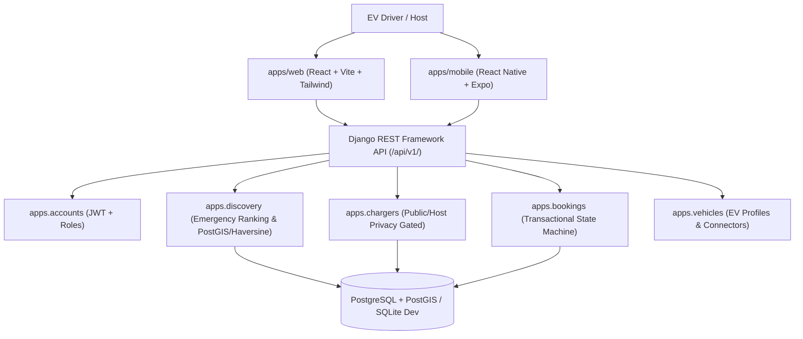

# ChargeNearby Architecture

## 1. System Topology

ChargeNearby operates as a unified community EV sharing and emergency discovery platform centered in Pune, Maharashtra.

## 2. Core Architectural Decisions

### 2.1 Monorepo Structure
- `backend/`: Django REST Framework with modular domain apps (`accounts`, `vehicles`, `chargers`, `discovery`, `bookings`, `core`).
- `apps/web/`: React 19 + TypeScript + Vite + Tailwind CSS responsive web portal.
- `apps/mobile/`: React Native + Expo + TypeScript mobile app with location permission handling and maps handoff.
- `docs/`: Comprehensive technical and operational specifications.

### 2.2 Privacy & Safety by Design
- **Public API Sanitization**: Endpoints `/api/v1/chargers/` and `/api/v1/discovery/nearby/` strictly exclude `exact_address` and `access_instructions`. Only the general public locality (e.g. "Koregaon Park, Pune") is shared.
- **Access Gating**: Confidential street addresses, house numbers, and gate/parking codes are only revealed to the authenticated driver and host once a booking reaches the `ACCEPTED`, `ARRIVED`, `CHARGING`, or `COMPLETED` state.
- **Host Self-Approval Prevention**: Hosts are strictly forbidden from approving their own listings. All listings require admin moderation.

### 2.3 Honest Geospatial Discovery
- Never promises reachability based solely on straight-line distance.
- Uses indexed spatial bounding boxes with spherical Haversine calculations and urban road detour multipliers (~1.35x for Pune traffic).
- Labels reachability confidence honestly (`REACHABLE`, `UNCERTAIN`, `CRITICAL`, `UNKNOWN`).
- Provides fallback Pune public DC fast charging hubs when no private chargers are available in radius.
