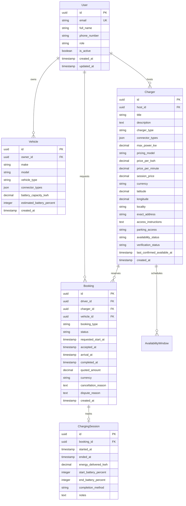

# ChargeNearby Database Schema

## 1. Entity Relationship Diagram

## 2. Key Constraints & Indices
- **Primary Keys**: UUIDv4 across public entities.
- **Geospatial & Filtering Indices**:
  - `chargers`: composite index on `(verification_status, availability_status)`, spatial indices on `(latitude, longitude)`.
  - `bookings`: composite indices on `(driver, status)`, `(charger, status)`, `(status, requested_start_at)`.
- **Currency Arithmetic**: Strict decimal format in INR (no floats).
- **Concurrency Protection**: Database row-locking (`select_for_update()`) on booking state mutations preventing double booking.
